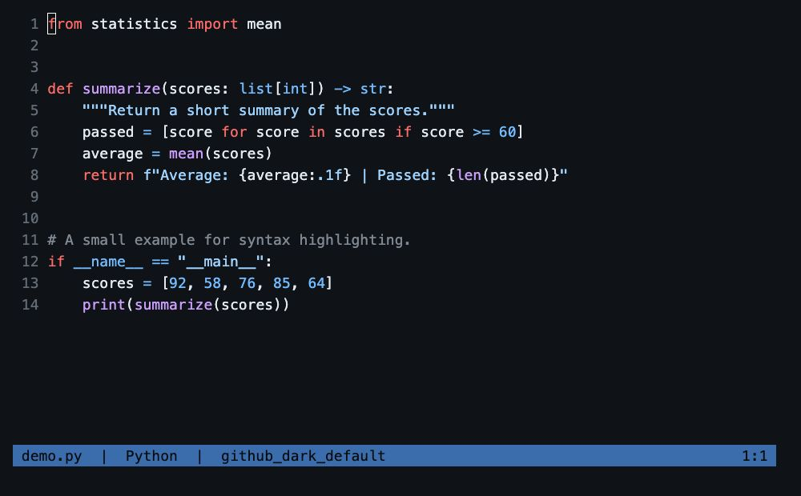

Neovim에서 GitHub처럼 코드를 읽고 싶다면 구문 강조(syntax highlighting)와 색상 테마를 함께 설정하면 됩니다. 이 글에서는 별도의 플러그인(plugin) 관리자 없이 Neovim 기본 패키지 기능으로 Tree-sitter와 GitHub 테마를 설치합니다.

## 설정 환경

- macOS와 Homebrew
- Neovim 0.12.5
- Lua 설정 파일: `~/.config/nvim/init.lua`
- 플러그인 설치 방식: `pack/*/start` 디렉터리 사용

아래 절차는 2026년 11월 7일 확인한 공식 문서와 설치된 환경을 기준으로 정리했습니다. Python 예제에서 테마와 구문 강조가 적용되는 것을 확인했습니다. 새 환경에서 도구와 플러그인을 처음 설치하는 과정은 별도로 재실행하지 않았습니다.

## Tree-sitter와 테마의 역할

Tree-sitter는 코드를 구문 트리로 분석합니다. Neovim은 여기에 강조 규칙을 적용해 키워드, 문자열, 함수 등을 구분하고 색상 테마는 각 항목을 어떤 색으로 표시할지 정합니다.

이 글에서는 `nvim-treesitter`의 기본 설정과 강조 규칙을 사용하고 `github-nvim-theme`으로 GitHub 색상을 적용합니다. GitHub와 Neovim의 언어별 강조 규칙은 다를 수 있으므로 모든 코드가 완전히 같은 색으로 표시되는 것은 아닙니다.

## 1. 현재 설정 확인하기

Neovim 안에서 다음 명령을 실행합니다.

```vim
:version
:echo $MYVIMRC
:scriptnames
```

각 명령으로 Neovim 버전, 현재 설정 파일, 로드된 스크립트를 확인할 수 있습니다. `:Lazy`로 플러그인 관리 화면이 열리면 `lazy.nvim`이 로드된 환경입니다. `E492: Not an editor command: Lazy`가 나오면 현재 세션에서는 로드되지 않은 상태입니다.

기존에 `~/.config/nvim/pack/github/start/copilot.vim`처럼 플러그인을 설치했다면 아래에서도 같은 디렉터리 구조를 사용하면 됩니다.

## 2. 필요한 도구 설치하기

다음은 **터미널에서** 실행합니다.

```sh
brew install tree-sitter-cli
```

설치된 CLI와 C 컴파일러를 확인합니다.

```sh
tree-sitter --version
cc --version
```

이 글에서 확인한 `nvim-treesitter`의 `main` 브랜치는 Neovim 0.12 이상, `tree-sitter-cli` 0.26.1 이상, C 컴파일러, `tar`, `curl`을 요구합니다. CLI는 npm 대신 시스템 패키지 관리자로 설치하도록 안내하고 있습니다. [공식 요구사항](https://github.com/nvim-treesitter/nvim-treesitter/blob/19bdfc04f40ed2ccb3340591d125f759b0406875/README.md#requirements)

컴파일러가 없다면 macOS 개발 도구를 설치하고 설치가 끝난 뒤 다시 확인합니다.

```sh
xcode-select --install
```

## 3. 플러그인 설치하기

**터미널에서** 다음 두 명령을 실행합니다.

```sh
git clone --branch main \
  https://github.com/nvim-treesitter/nvim-treesitter.git \
  ~/.config/nvim/pack/github/start/nvim-treesitter

git clone https://github.com/projekt0n/github-nvim-theme.git \
  ~/.config/nvim/pack/github/start/github-nvim-theme
```

Neovim은 기본 패키지 경로의 `start` 디렉터리에 설치된 플러그인을 시작할 때 자동으로 로드합니다. 이미 설치한 디렉터리가 있다면 해당 `git clone` 명령은 생략합니다.

`nvim-treesitter`의 `main`은 기존 버전과 설정 방식이 다릅니다. 예전 예제의 `require("nvim-treesitter.configs").setup(...)`나 `highlight = { enable = true }`를 섞어 사용하지 않습니다. [공식 설치 문서](https://github.com/nvim-treesitter/nvim-treesitter/blob/19bdfc04f40ed2ccb3340591d125f759b0406875/README.md#installation)

## 4. init.lua 설정하기

**Neovim에서** 설정 파일을 엽니다.

```vim
:edit ~/.config/nvim/init.lua
```

기존 설정을 유지하면서 아래 코드를 추가합니다. 기존에 `vim.cmd.colorscheme("desert")` 등 다른 테마를 지정하는 줄이 있다면 GitHub 테마 설정으로 교체합니다. 뒤에서 다른 테마를 다시 적용하는 코드가 남아 있으면 그 테마가 최종 적용됩니다.

```lua
vim.opt.termguicolors = true
vim.cmd.colorscheme("github_dark_default")

vim.api.nvim_create_autocmd("FileType", {
  group = vim.api.nvim_create_augroup("TreesitterHighlight", {
    clear = true,
  }),
  callback = function(args)
    local lang = vim.treesitter.language.get_lang(args.match)
    if lang and vim.treesitter.language.add(lang) then
      vim.treesitter.start(args.buf, lang)
    end
  end,
})
```

이 코드는 파일 형식에 대응하는 구문 분석기(parser, 이하 파서)를 찾고 로드할 수 있으면 Tree-sitter 강조를 시작합니다. 파서를 자동 설치하지는 않으므로 사용할 언어는 다음 단계에서 설치해야 합니다.

`nvim-treesitter`의 기본값을 사용하므로 별도의 `setup()` 호출은 필요 없습니다. 다만 구문 강조는 자동으로 활성화되지 않아 위와 같이 별도로 켭니다. [Tree-sitter 설정 문서](https://github.com/nvim-treesitter/nvim-treesitter/blob/19bdfc04f40ed2ccb3340591d125f759b0406875/README.md#setup)

`Esc`를 누르고 `:w`로 저장합니다. 다른 작업 중인 파일도 저장한 다음 Neovim을 종료하고 다시 실행합니다.

## 5. 언어 파서 설치하기

재시작한 **Neovim에서** Python 파서를 설치합니다.

```vim
:TSInstall python
```

다른 언어도 필요하면 추가합니다.

```vim
:TSInstall lua javascript typescript tsx json html css
```

설치 완료 메시지를 확인하고 코드 파일을 다시 엽니다. 현재 파일을 그대로 유지하면서 강조를 시작하려면 다음 명령을 사용할 수 있습니다.

```vim
:lua vim.treesitter.start()
```

## 6. 적용 확인하기

Python 파일에서 `import`, `if`, 문자열 등에 커서를 두고 실행합니다.

```vim
:Inspect
```

출력에 Tree-sitter의 `@keyword`나 `@string` 같은 항목이 표시되는지 확인합니다. 현재 테마도 확인할 수 있습니다.

```vim
:colorscheme
```

`github_dark_default`가 표시되면 테마가 적용된 상태입니다. 단순히 색상이 보인다는 사실만으로 Tree-sitter가 켜졌다고 판단하지 말고 `:Inspect`로 함께 확인합니다.

## Python 코드로 보는 적용 결과

아래는 `demo.py`를 실제 Neovim에서 연 화면입니다. `from`, `def`, `if` 같은 키워드는 붉은색, 함수 이름은 보라색, 문자열은 옅은 파란색으로 구분됩니다.


*Neovim 0.12.5에서 Python 예제를 연 화면. 실행 중인 Neovim의 터미널 출력을 로컬 브라우저의 xterm.js에 표시해 촬영했습니다.*

화면의 예제를 `demo.py`로 저장합니다.

```python
from statistics import mean


def summarize(scores: list[int]) -> str:
    """Return a short summary of the scores."""
    passed = [score for score in scores if score >= 60]
    average = mean(scores)
    return f"Average: {average:.1f} | Passed: {len(passed)}"


# A small example for syntax highlighting.
if __name__ == "__main__":
    scores = [92, 58, 76, 85, 64]
    print(summarize(scores))
```

본문의 `init.lua` 설정과 Python 파서가 준비된 상태에서 다음 명령으로 엽니다.

```sh
nvim demo.py
```

촬영할 때는 기존 개인 설정과 구분하기 위해 본문의 Lua 설정을 `/tmp/neovim-blog/init.lua`에 저장하고 아래 표시 설정을 덧붙였습니다. 줄 번호와 상태 표시줄만 추가한 것으로, 구문 강조 규칙은 바꾸지 않았습니다.

```lua
vim.opt.number = true
vim.opt.laststatus = 2
vim.opt.statusline = " demo.py  |  Python  |  github_dark_default %= %l:%c "
vim.opt.swapfile = false
```

```sh
nvim -i NONE -u /tmp/neovim-blog/init.lua demo.py
```

촬영 환경은 macOS 27.2, Neovim 0.12.5, `tree-sitter-cli` 0.27.2입니다. 터미널은 88열 × 22행으로 열고 xterm.js 5.5.0에서 Menlo 18px로 표시했습니다. 설치된 구성 요소의 버전은 다음과 같습니다.

| 구성 요소 | 촬영에 사용한 버전 |
| --- | --- |
| `nvim-treesitter` | [`19bdfc04f40e`](https://github.com/nvim-treesitter/nvim-treesitter/commit/19bdfc04f40ed2ccb3340591d125f759b0406875) |
| `github-nvim-theme` | [`c106c9472154`](https://github.com/projekt0n/github-nvim-theme/commit/c106c9472154d6b2c74b74565616b877ae8ed31d) |
| Python 파서 | [`tree-sitter-python` v0.25.0](https://github.com/tree-sitter/tree-sitter-python/tree/v0.25.0) |

같은 예제에서 Neovim의 강조 항목을 조회하면 12행의 `if`는 `@keyword.conditional`, `"__main__"`은 `@string`으로 확인됩니다. 테마 이름은 `github_dark_default`이며 Tree-sitter 강조도 활성화된 상태입니다. 이 확인은 Python 예제에 한하며, 다른 언어의 파서 설치와 강조는 이번에 검증하지 않았습니다.

## GitHub 테마 선택하기

GitHub에서 사용하는 화면 모드에 맞춰 `colorscheme` 이름을 바꾸면 됩니다.

| GitHub 화면 모드 | Neovim 테마 이름 |
|---|---|
| Dark default | `github_dark_default` |
| Dark dimmed | `github_dark_dimmed` |
| Light default | `github_light_default` |

예를 들어 밝은 테마를 쓰려면 다음처럼 설정합니다.

```lua
vim.cmd.colorscheme("github_light_default")
```

테마 종류와 GitHub 화면 모드의 대응은 [테마 공식 문서](https://github.com/projekt0n/github-nvim-theme#supported-colorschemes--comparisons)에서 확인할 수 있습니다.

## 문제가 생겼을 때

### TSInstall 명령을 찾을 수 없는 경우

플러그인 설치 경로가 `~/.config/nvim/pack/github/start/nvim-treesitter`인지 확인합니다. 설치 후 Neovim을 재시작했는지도 확인합니다. 설정 디렉터리를 별도로 지정한 환경이라면 `:echo stdpath('config')`의 경로를 기준으로 설치 위치를 조정합니다.

### GitHub 테마를 찾을 수 없는 경우

`github-nvim-theme` 디렉터리가 같은 `start` 경로 아래에 있는지 확인합니다. 테마를 설치하기 전에 설정부터 추가했다면 플러그인 설치를 마치고 Neovim을 다시 실행합니다.

### 파서 설치에 실패하는 경우

실제 오류 메시지를 먼저 확인합니다. 터미널에서 `tree-sitter --version`과 `cc --version`을 확인하고 Neovim에서는 다음 진단을 실행합니다.

```vim
:checkhealth nvim-treesitter
```

### 테마 변경이 반영되지 않는 경우

뒤에서 실행되는 다른 `colorscheme` 설정이 있는지 확인합니다. 테마 캐시 문제라면 플러그인에서 안내하는 명령을 실행합니다.

```vim
:GithubThemeCompile
```

## 업데이트하기

기본 패키지 방식에서는 Git으로 플러그인을 직접 업데이트합니다. **터미널에서** 실행합니다.

```sh
git -C ~/.config/nvim/pack/github/start/nvim-treesitter pull --ff-only
git -C ~/.config/nvim/pack/github/start/github-nvim-theme pull --ff-only
```

이후 Neovim을 재시작하고 파서도 업데이트합니다.

```vim
:TSUpdate
```

플러그인과 파서는 서로 맞는 버전이 필요하므로 `nvim-treesitter` 업데이트 후에는 파서 업데이트도 함께 진행합니다.

## 참고 문서

- [Neovim Tree-sitter 문서](https://neovim.io/doc/user/treesitter/)
- [Neovim 기본 패키지 문서](https://neovim.io/doc/user/pack/)
- [nvim-treesitter](https://github.com/nvim-treesitter/nvim-treesitter)
- [GitHub Neovim Theme](https://github.com/projekt0n/github-nvim-theme)
