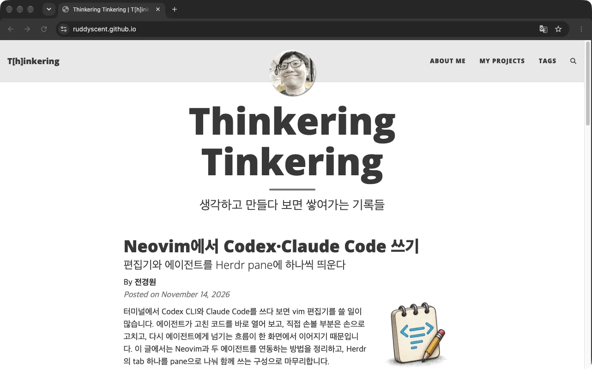

Codex CLI로 웹앱을 개발하거나 웹 페이지에서 자료를 모으게 하면 에이전트가 브라우저를 씁니다. 에이전트가 Chrome을 붙잡고 있는 동안에는 제가 Chrome을 쓰기 어렵습니다. Edge를 설치해 에이전트에게 넘기면 조금 나아지지만, 그래도 에이전트 두 개가 동시에 작업하는 것이 한계였습니다. 이 글에서는 이 제한이 왜 생기는지 살펴보고, 에이전트마다 독립된 브라우저를 띄워 동시 작업 수를 늘리는 구성을 Codex CLI와 Claude Code CLI 기준으로 정리합니다.

## 원인: 모든 에이전트가 브라우저 하나를 나눠 쓴다

[Chrome DevTools MCP](https://github.com/ChromeDevTools/chrome-devtools-mcp)나 브라우저 확장 방식은 대개 이미 실행 중인 실제 Chrome에 붙습니다. 같은 프로필, 같은 원격 디버깅 포트를 여러 에이전트가 함께 쓰면 서로 탭을 건드리거나, 나중에 붙은 에이전트가 먼저 붙은 에이전트의 연결을 끊습니다. [playwright-parallel-mcp](https://glama.ai/mcp/servers/k7torwfgds)의 설명도 같은 문제를 지적합니다. 기존 브라우저 자동화 MCP 서버는 모든 세션이 브라우저 인스턴스 하나를 공유하므로 여러 에이전트가 동시에 쓰면 충돌한다는 것입니다.

Edge를 추가로 설치할 수는 있지만, 이건 공유할 브라우저를 하나 더 만든 것에 불과합니다. 해결 방향은 브라우저 개수를 늘리는 것이 아니라, 에이전트가 사용자의 브라우저를 쓰지 않고 자기만의 브라우저를 띄우게 하는 것입니다. 이렇게 하면 CPU와 메모리가 허용하는 한, 여러개의 브라우저에서 동시에 작업할 수 있게 됩니다.

## Codex CLI: Playwright MCP를 isolated 모드로 붙인다

[Playwright MCP](https://github.com/microsoft/playwright-mcp)는 [Model Context Protocol(MCP)](https://modelcontextprotocol.io/)로 브라우저 조작 도구를 에이전트에 제공하는 서버입니다. 핵심은 `--isolated` 옵션입니다. 이 옵션을 주면 브라우저 프로필을 메모리에만 두고 디스크에 저장하지 않습니다.

`@playwright/mcp` 0.0.85는 기본값으로 설치된 Google Chrome 실행 파일을 씁니다. 그래도 제가 쓰는 Chrome 창에 붙는 것이 아니라, 별도 프로필을 가진 Chrome 프로세스를 새로 띄웁니다. 제 탭, 로그인, 확장 프로그램과는 섞이지 않습니다. Codex CLI에는 다음 명령으로 등록합니다.

```sh
codex mcp add playwright -- npx -y @playwright/mcp@latest --isolated
```

`--` 뒤가 Codex가 실행할 서버 명령입니다. [`npx`](https://docs.npmjs.com/cli/commands/npx)는 Node.js와 함께 설치되는 npm 도구로, npm 패키지를 미리 설치하지 않아도 내려받아 바로 실행합니다. 패키지가 캐시에 없으면 설치할지 묻는데, `-y`는 이 질문에 자동으로 "예"라고 답합니다. 이 옵션이 왜 필요한지는 뒤에서 다시 설명합니다.

같은 설정을 `~/.codex/config.toml`에 직접 쓸 수도 있습니다.

```toml
[mcp_servers.playwright]
command = "npx"
args = ["-y", "@playwright/mcp@latest", "--isolated"]
startup_timeout_sec = 60
```

MCP 서버는 Codex 세션마다 별도 프로세스로 실행됩니다. 터미널 다섯 개에서 Codex를 다섯 개 실행하면 브라우저도 다섯 개가 서로 독립적으로 뜹니다. Chrome DevTools MCP의 콘솔·네트워크 분석 기능이 필요하다면 같은 방식으로 `npx -y chrome-devtools-mcp@latest --isolated`를 등록합니다.

에이전트가 브라우저를 쓰면 이렇게 뜬 창을 눈으로 확인할 수 있습니다. 툴바에 프로필 아이콘도 확장 프로그램도 없는 빈 Chrome 창이 따로 뜹니다. 아래 화면은 `npx -y @playwright/mcp@0.0.85 --isolated --viewport-size 1280x720 --port 8931`로 서버를 띄우고 `browser_navigate` 도구로 블로그 첫 페이지를 연 것입니다. 번역 안내 창이 화면을 가리지 않도록 설정 파일에서 `--lang=en-US` 실행 인자를 추가했습니다.


*Playwright MCP가 띄운 별도 Chrome 창 (macOS 27.2, Google Chrome 157.0.8103.51, `@playwright/mcp` 0.0.85)*

### 창을 띄우지 않으려면

에이전트가 여럿 돌 때 창이 계속 뜨는 것이 번거롭거나, 화면이 없는 서버에서 실행한다면 `--headless`를 추가합니다. 창 없이 브라우저를 실행하는 옵션으로, 브라우저를 에이전트마다 분리하는 것과는 별개입니다. 분리는 `--isolated`가 맡으므로 `--headless`는 필요에 따라 붙이면 됩니다.

```sh
codex mcp add playwright -- npx -y @playwright/mcp@latest --headless --isolated
```

### 세션 하나에서 서브에이전트를 병렬로 돌릴 때

Codex의 멀티 에이전트 기능처럼 세션 하나 안에서 서브에이전트를 여러 개 띄우면 이들이 MCP 서버 하나를 함께 쓸 수 있습니다. 이때는 두 가지 방법이 있습니다.

- 세션마다 별도 백엔드 프로세스를 띄우는 [playwright-parallel-mcp](https://glama.ai/mcp/servers/k7torwfgds) 같은 래퍼를 씁니다.
- 같은 서버를 `browser-1`, `browser-2`처럼 이름만 바꿔 여러 개 등록하고, 에이전트마다 다른 이름을 쓰도록 지시합니다.

### 로그인이 필요한 사이트

임시 프로필에는 로그인 정보가 없습니다. 한 번 로그인한 뒤 쿠키와 localStorage를 storage state 파일로 저장해 두고 `--storage-state` 옵션으로 넘기면, 실제 Chrome을 쓰지 않고도 로그인된 상태에서 작업할 수 있습니다.

## 자료 수집은 MCP 대신 스크립트로 맡긴다

반복적인 크롤링이라면 에이전트가 MCP 도구로 페이지를 한 단계씩 클릭하게 하기보다, Playwright나 Python 스크립트를 작성해 headless로 실행하게 하는 편이 낫습니다. 스크립트는 셸 명령만으로 돌아가므로 MCP 설정과 무관하게 병렬로 늘릴 수 있습니다. 토큰도 적게 씁니다. [Daniel Vaughan의 정리](https://codex.danielvaughan.com/2026/08/14/codex-cli-playwright-mcp-browser-automation-accessibility-snapshots-testing/)에 따르면 Playwright MCP는 세션당 약 114,000 토큰, Playwright CLI는 약 27,000 토큰을 씁니다. MCP는 화면을 보며 판단해야 하는 탐색과 디버깅에 남겨 둡니다.

브라우저와 함께 dev 서버 포트도 확인해야 합니다. 웹앱을 병렬로 개발하면 브라우저보다 포트가 먼저 부딪히는 경우가 많습니다. 에이전트마다 git worktree를 나누고 3001, 3002처럼 포트를 따로 지정하게 하면 이 충돌을 피할 수 있습니다. 실제 Chrome에 꼭 붙어야 하는 작업이라면 에이전트마다 `--user-data-dir`과 `--remote-debugging-port`를 다르게 준 Chrome 인스턴스를 띄워 평소 쓰는 프로필과 분리합니다.

## Claude Code CLI도 구조는 같다

Claude Code의 Claude in Chrome(`claude --chrome`)은 제 실제 Chrome을 직접 조작합니다. 로그인 상태를 그대로 쓸 수 있어 편리하지만, 앞에서 본 것과 같은 경합이 생깁니다. 그래서 제 로그인이 반드시 필요한 작업에만 쓰고, 병렬 작업에는 Codex와 같은 Playwright MCP를 등록합니다.

```sh
claude mcp add playwright -- npx -y @playwright/mcp@latest --isolated
```

`--scope project`를 붙이면 설정이 저장소의 `.mcp.json`에 기록되어 프로젝트 단위로 공유됩니다. 터미널마다 `claude`를 실행하면 세션마다 MCP 서버 프로세스가 따로 떠서 브라우저도 분리됩니다.

서브에이전트는 조금 다릅니다. [Claude Code 서브에이전트 문서](https://docs.anthropic.com/en/docs/claude-code/sub-agents)에 따르면 서브에이전트는 기본적으로 부모 대화의 MCP 도구를 물려받고, 이때는 부모 세션의 연결을 그대로 함께 씁니다. 서브에이전트 여러 개가 동시에 `playwright` 서버를 부르면 결국 브라우저 하나를 나눠 쓰게 됩니다. 대신 서브에이전트 정의의 `mcpServers` 항목에 서버를 직접 정의하면, 그 서버는 서브에이전트가 시작될 때 연결되고 끝날 때 끊깁니다. 서브에이전트마다 자기 Playwright 서버와 브라우저를 갖게 됩니다.

```markdown
---
name: web-researcher
description: 웹 페이지를 열어 자료를 수집한다
mcpServers:
  - playwright:
      type: stdio
      command: npx
      args: ["-y", "@playwright/mcp@latest", "--isolated"]
---
브라우저로 주어진 페이지를 열고 필요한 내용을 정리한다.
```

이 파일을 `.claude/agents/web-researcher.md`에 두면 됩니다. 프로젝트 폴더의 서브에이전트에 정의한 서버는 그 폴더를 신뢰한다고 승인한 뒤에 실행됩니다. 직접 정의한 서버의 도구는 부모 대화에 노출되지 않으므로 부모 세션의 도구 목록도 깔끔하게 유지됩니다.

## 실행 중인 세션에 적용하기

Codex CLI에는 실행 중인 스레드가 다음 턴에 MCP 서버를 다시 초기화하는 기능([#8957](https://github.com/openai/codex/pull/8957))이 있고, 앱 서버 스레드는 `config.toml` 변경을 재시작 없이 반영합니다. 다만 대화형 TUI에서 새로 추가한 서버가 언제 붙는지는 공식 문서에 명확히 나와 있지 않습니다. 설정을 추가한 뒤 실행 중인 대화에서 `/mcp`를 입력해 `playwright`가 목록에 보이면 그대로 쓰면 됩니다. 보이지 않으면 대화를 잃지 않고 다음 순서로 다시 엽니다.

1. 다른 터미널에서 `codex mcp add ...`로 설정을 추가합니다.
2. 실행 중인 Codex를 종료합니다.
3. `codex resume --last`로 방금 대화를 다시 엽니다. 다른 대화라면 `codex resume`으로 목록에서 고릅니다.

대화 맥락은 그대로 남고 새 MCP 도구가 붙습니다. Claude Code도 같은 방식으로 `claude mcp add`로 추가한 뒤 대화 안에서 `/mcp`로 연결 여부를 확인하고, 보이지 않으면 `claude --continue`나 `claude --resume`으로 다시 열어 이어 갑니다.

다시 시작하기 어려운 상황이라면 앞에서 본 스크립트 방식을 지금 대화에 바로 지시할 수 있습니다. 셸 명령만 쓰므로 설정 변경이 필요 없습니다.

## `npx -y`를 붙이는 이유와 함께 챙길 것

위 예시의 `npx`에는 모두 `-y`를 붙였습니다. MCP 서버는 터미널 입력 없이 백그라운드에서 실행됩니다. 이때 npx가 설치 여부를 물으면 답할 사람이 없으니 기동이 멈추거나 타임아웃이 납니다. `-y`가 이 질문을 건너뛰게 해 줍니다.

`-y`는 npm 패키지 설치만 건너뛰게 합니다. 브라우저 실행 파일은 따로 챙겨야 합니다. 기본값은 설치된 Google Chrome이므로 Chrome이 있다면 추가 설치가 필요 없습니다. Chrome이 없는 환경이거나 `--browser`로 다른 브라우저를 지정했다면 해당 브라우저를 한 번 설치합니다.

```sh
npx -y playwright install chrome
```

첫 실행은 패키지를 내려받느라 느려서 기본 기동 시간 제한을 넘길 수 있습니다. 앞의 설정처럼 `startup_timeout_sec`을 늘리거나, 위 설치 명령을 미리 실행해 캐시를 채워 둡니다.

`@latest`와 `-y`를 함께 쓰면 새 버전을 확인 없이 받아 실행합니다. 편하지만 공급망 위험이 커지고, 업데이트로 동작이 바뀔 수도 있습니다. 안정성이 중요하다면 `@playwright/mcp@0.0.xx`처럼 버전을 고정하거나, `npm i -g @playwright/mcp`로 전역 설치한 뒤 `mcp-server-playwright`를 직접 실행합니다. 전역 설치는 기동도 가장 빠릅니다.

## 정리

평소 구성은 isolated 모드의 Playwright MCP를 기본으로 두고, 로그인이 필요하면 storage state를 넘깁니다. 실제 Chrome에 붙는 Claude in Chrome이나 원격 디버깅 연결은 제 로그인 세션이 꼭 필요한 작업에만 씁니다. 이렇게 나누면 에이전트가 몇 개 돌아가든 제 Chrome은 제 것으로 남습니다.
