비밀번호 없이 지문이나 Face ID만으로 구글에 로그인하는 **[패스키(passkey)](https://fidoalliance.org/passkeys/)**를 설정해 봤습니다. 저는 패스키를 두 개 만들어서 하나는 **iCloud 키체인**에, 하나는 **1Password**에 저장해 두었습니다.

이 글에서는 패스키가 무엇인지부터 시작해서 Mac과 iPhone 설정, 구글 계정에 패스키를 등록하는 과정, 그리고 제가 겪은 문제를 해결한 방법까지 순서대로 정리했습니다.

## 1. 패스키란?

패스키는 **비밀번호를 대신하는 로그인 방식**입니다. 무언가를 외우거나 입력하지 않고, 기기의 지문·얼굴 인식이나 화면 잠금 PIN으로 로그인합니다.

### 동작 원리: 열쇠 한 쌍과 서명

패스키는 [공개키 암호(public-key cryptography)](https://ko.wikipedia.org/wiki/공개_키_암호_방식)를 사용합니다. 구글 계정에 패스키를 등록하면 기기가 **열쇠 한 쌍**을 만듭니다.

| 열쇠 | 보관 장소 | 역할 |
|---|---|---|
| 개인키 | 패스키 관리자 (iCloud 키체인, 1Password 등) | 서버로 보내지 않음. 기기 사이에는 암호화된 채로 동기화 |
| 공개키 | 구글 서버 | 서명이 진짜인지 확인 |

로그인할 때는 구글이 무작위 값(challenge)을 보내고, 내 기기가 개인키로 서명해서 돌려줍니다. 구글은 공개키로 서명을 확인하고 로그인을 허락합니다. 지문이나 얼굴은 **개인키 금고를 여는 열쇠** 역할만 할 뿐이라서, 생체 정보가 구글로 전송되지 않습니다.

### 비밀번호보다 좋은 점

- **피싱(phishing)에 강합니다.** 패스키는 등록한 도메인(`google.com`)에 묶여 있어서, 가짜 사이트에서는 아예 동작하지 않습니다.
- **서버가 털려도 안전합니다.** 서버에는 공개키만 있으니 훔쳐 가도 쓸 데가 없습니다.
- **재사용 문제가 없습니다.** 사이트마다 다른 열쇠가 자동으로 만들어집니다.
- **편합니다.** 외울 것도, 입력할 것도 없습니다.

### 저장 위치: 패스키 관리자

패스키는 **패스키 관리자**에 저장됩니다. Apple 기기라면 **iCloud 키체인**(암호 앱)이 기본이고, 1Password나 Google 비밀번호 관리자 같은 서드파티 관리자를 쓸 수도 있습니다. 클라우드로 동기화되는 관리자를 쓰면 휴대폰을 잃어버려도 새 기기에서 그대로 쓸 수 있어요.

저는 Apple 기기에서는 iCloud 키체인을, 그 밖의 환경에서는 1Password를 쓰려고 **두 곳에 각각 패스키를 만들기로** 했습니다. 패스키는 한 계정에 여러 개를 등록할 수 있어서, 하나가 문제 생겨도 다른 하나로 로그인할 수 있다는 장점도 있어요.

## 2. 준비하기: iPhone과 Mac 설정

구글에 패스키를 만들기 전에 **iCloud 키체인 동기화**와 **자동 완성 제공자**를 먼저 켜 둡니다. 이 설정을 해 둬야 Mac에서 만든 패스키를 iPhone에서도 쓸 수 있고, 반대로도 됩니다.

> 메뉴 이름은 iOS·macOS 버전에 따라 조금씩 다를 수 있습니다.

### 2-1. iPhone

**① iCloud 키체인 동기화 켜기**

`설정` → 맨 위의 `[내 이름]` → `iCloud`로 들어가서 **iCloud에 저장됨** 영역의 **암호**를 누릅니다. 이어서 나오는 **암호 및 키체인** 화면에서 **이 iPhone 동기화**를 켭니다.

  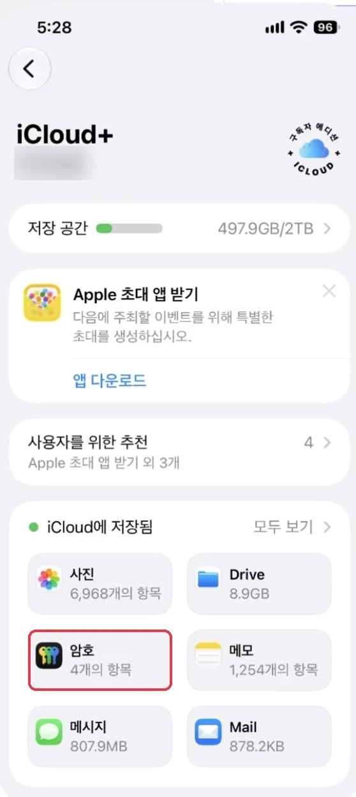
  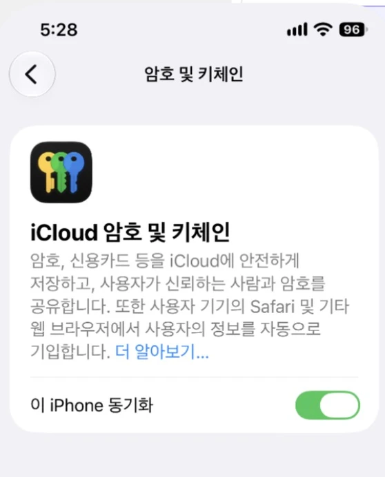

**② 자동 완성 제공자에 iCloud와 1Password 모두 켜기**

`설정` → `일반` → `자동 완성 및 암호`로 들어갑니다. **암호 및 패스키 자동 완성**을 켜고, **다음에서 자동 채우기** 목록에서 **암호**(Apple)와 **1Password**를 둘 다 켭니다.

  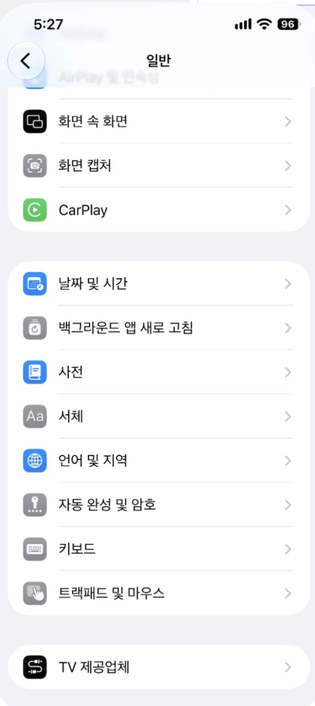
  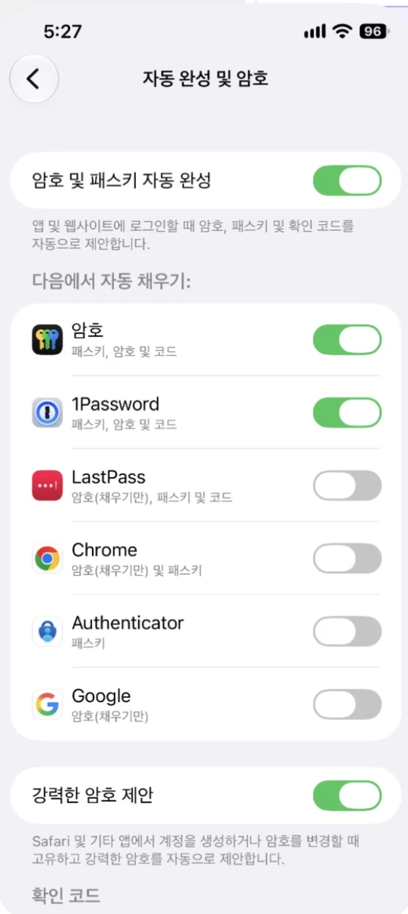

1Password만 켜져 있으면 패스키 선택 창에 1Password만 나옵니다. 둘 다 켜 두면 로그인할 때 어느 쪽 패스키를 쓸지 고를 수 있어요.

### 2-2. Mac

**① iCloud 키체인 동기화 켜기**

`시스템 설정` → 맨 위의 `[내 이름]`(Apple 계정) → `iCloud`로 들어갑니다. 설정 창 왼쪽 위 검색창에 `iCloud`를 입력해도 바로 찾을 수 있어요.

**iCloud에 저장됨** 영역에서 **암호** 타일이 `켬`으로 되어 있는지 확인합니다.

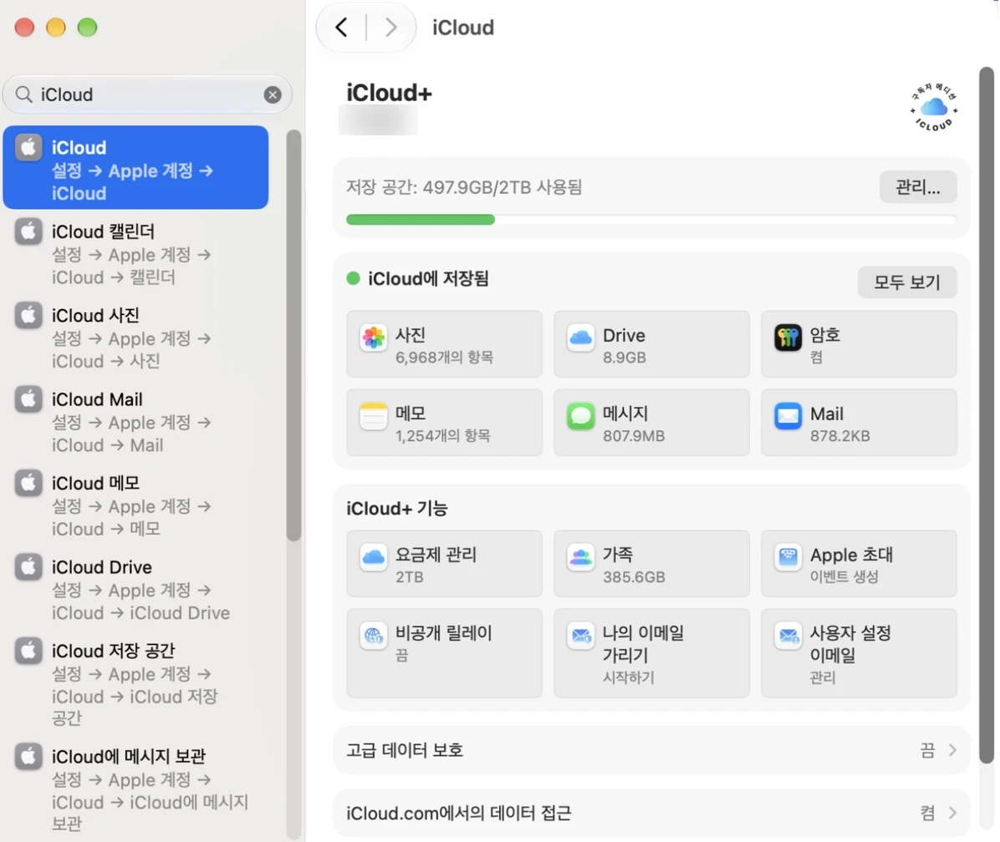

**암호** 타일을 누르면 열리는 창에서 **이 Mac 동기화**가 켜져 있어야 합니다.

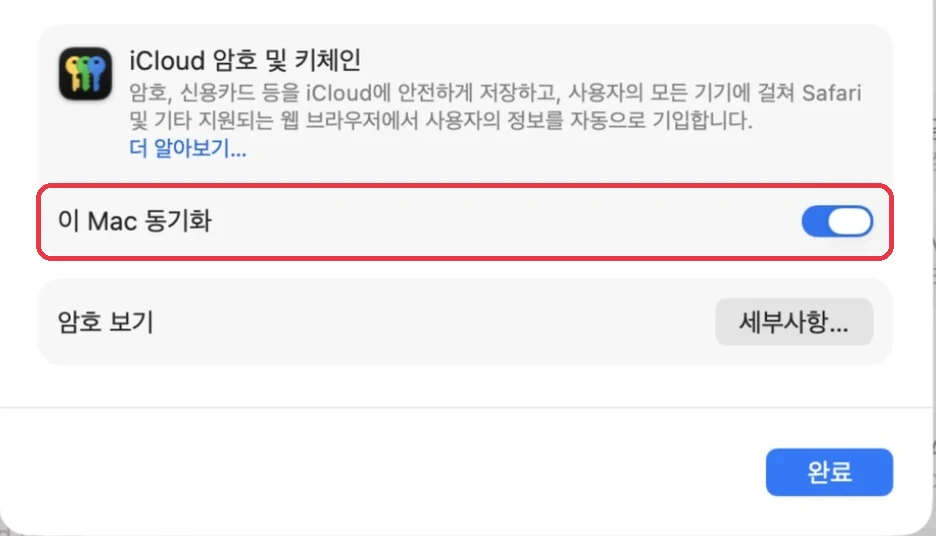

**② 자동 완성 제공자 설정**

`시스템 설정` → `일반` → `자동 완성 및 암호`로 들어갑니다.

- **암호 및 패스키 자동 완성**을 켭니다.
- **다음에서 자동 채우기** 목록에서 **암호**(Apple)와 **1Password**를 둘 다 켭니다.

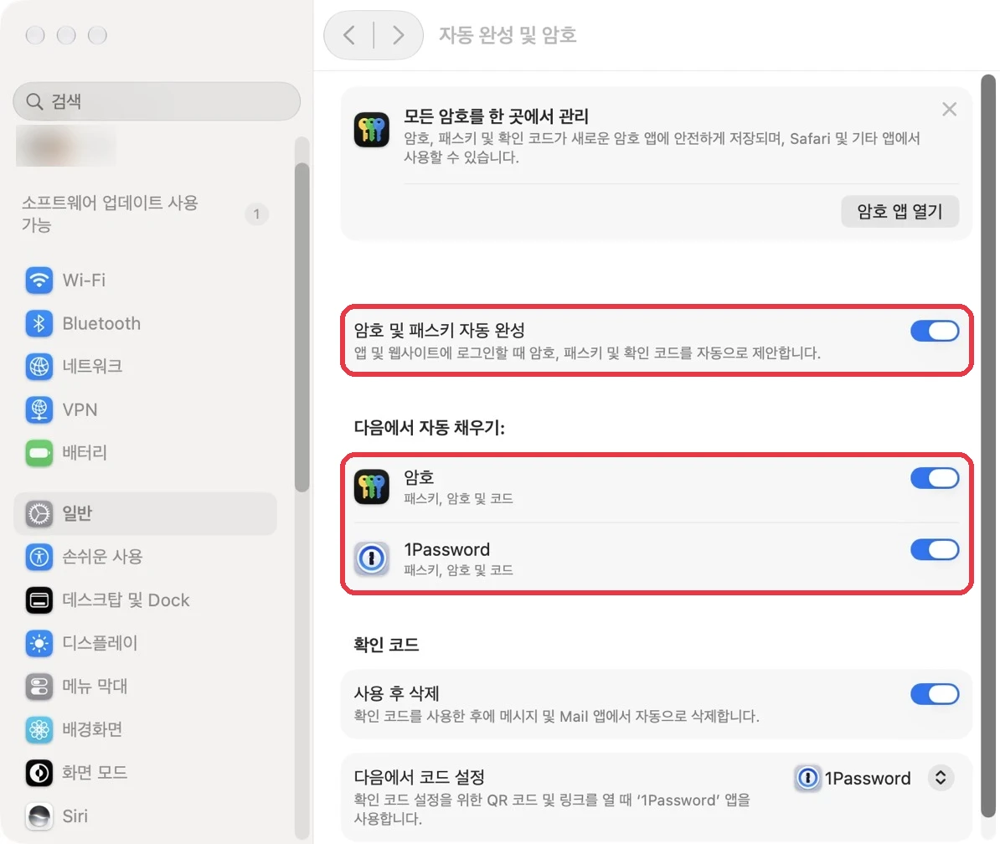

**③ 1Password 앱 설정 확인**

1Password 앱에서 메뉴 막대의 `1Password` → `설정…` → `자동으로 채우기`로 들어가 두 가지를 확인합니다.

- **패스키 제안 표시**가 체크되어 있어야 로그인할 때 1Password가 패스키를 보여 줍니다.
- **다음에서 자동 입력 제안 표시**에서 고른 계정(저는 `Our family`)에 있는 항목만 제안됩니다. 1Password 계정이 여러 개라면, 패스키를 저장할 계정과 이 설정이 일치해야 합니다.

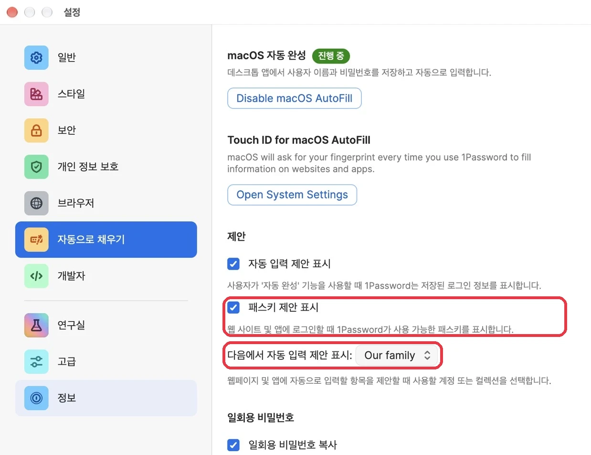

**④ (Chrome 사용자) 1Password 확장 프로그램 설정**

Chrome에서 1Password 확장 프로그램을 쓴다면 확장 프로그램 쪽 설정도 따로 확인해야 합니다. 확장 프로그램 설정은 브라우저 프로필마다 따로 저장되기 때문이에요.

툴바의 1Password 아이콘 → `⋯` → `설정` → `자동으로 채우기 및 저장`에서 **패스키로 로그인하도록 제안**을 켭니다.

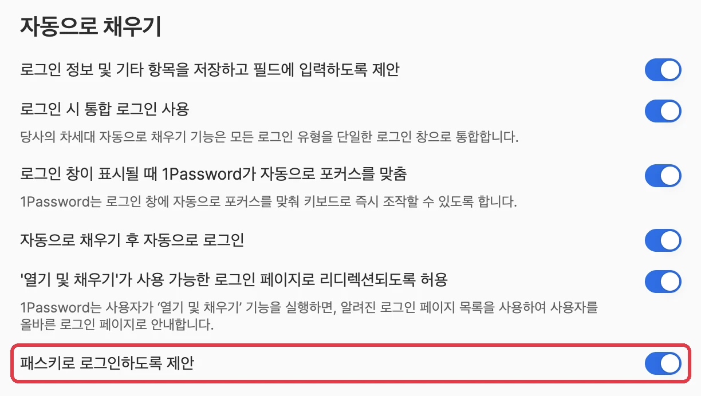

데스크톱 앱 설정(③)은 macOS 자동 완성을 거치는 경로를, 확장 프로그램 설정(④)은 Chrome 페이지 안에서 1Password 창을 바로 띄우는 경로를 맡습니다. 둘 다 켜 두는 게 가장 편해요. 이 설정들은 뒤의 5절 문제 해결에서 다시 다룹니다.

## 3. 구글 계정에 패스키 만들기

### 3-1. 패스키 메뉴 찾아가기

1. [myaccount.google.com](https://myaccount.google.com)에 접속합니다.
2. `보안` → `패스키 및 보안 키`로 들어갑니다. 비밀번호를 한 번 더 물어볼 수 있습니다.
3. **+ 패스키 생성** 버튼을 누릅니다.

### 3-2. 1Password에 저장하기

1Password 확장 프로그램이 켜져 있으면 **패스키 생성**을 눌렀을 때 1Password 저장 창이 먼저 뜹니다.

- 새 항목을 만들기보다 **기존 Google 로그인 항목에 저장(업데이트)**하는 걸 추천합니다. 비밀번호와 패스키가 한 항목에 모여서 관리하기 편합니다.
- 저장할 **볼트**를 확인하세요. 나중에 어디 저장했는지 헷갈리지 않도록요.

### 3-3. iCloud 키체인에 저장하기

다시 **+ 패스키 생성**을 누르고, 이번에는 1Password 창 대신 macOS 기본 창으로 넘어가서 iCloud 키체인에 저장합니다. 1Password 창을 닫으면 보통 macOS 창이 뜹니다. Touch ID로 확인하면 끝입니다.

iPhone에서 만들어도 됩니다. Safari로 같은 페이지에 들어가서 **패스키 생성** → Face ID로 확인하면 iCloud 키체인에 저장되고, Mac으로도 동기화됩니다.

### 3-4. 등록 확인

두 개를 다 만들면 `패스키 및 보안 키` 페이지에 이렇게 보입니다. 각 패스키 옆에 **어디에 저장됐는지**(iCloud 키체인, 1Password)와 생성 시각이 표시됩니다.

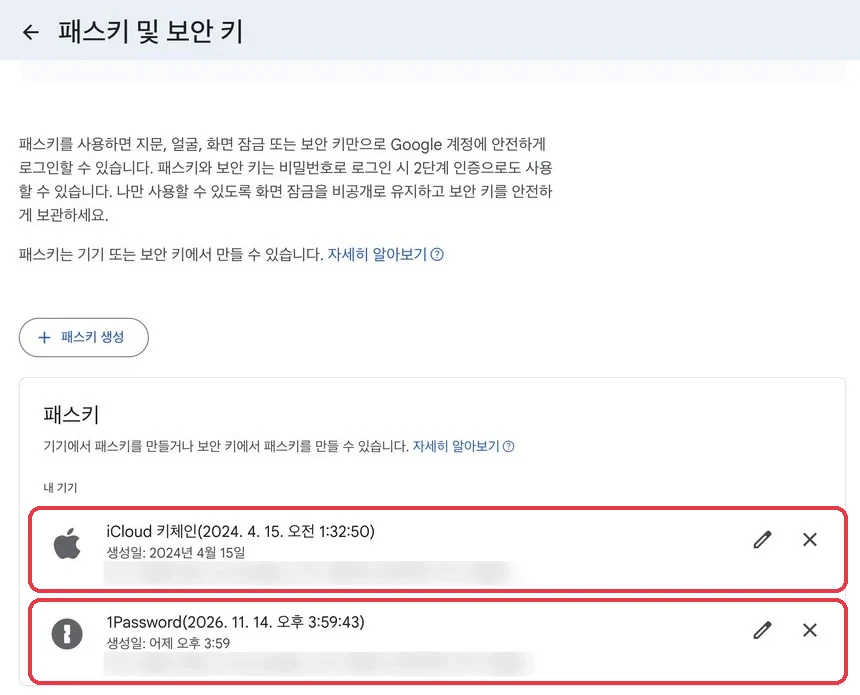

여기 표시된 **생성 시각**을 기억해 두세요. 나중에 1Password에서 패스키 항목을 찾을 때 단서가 됩니다.

## 4. 패스키로 로그인해 보기

시크릿 창을 열고 구글에 로그인해 봅니다. 이메일을 입력하면 **패스키를 사용하여 본인임을 확인해 주세요** 화면이 나오고, 패스키 선택 창이 뜹니다.

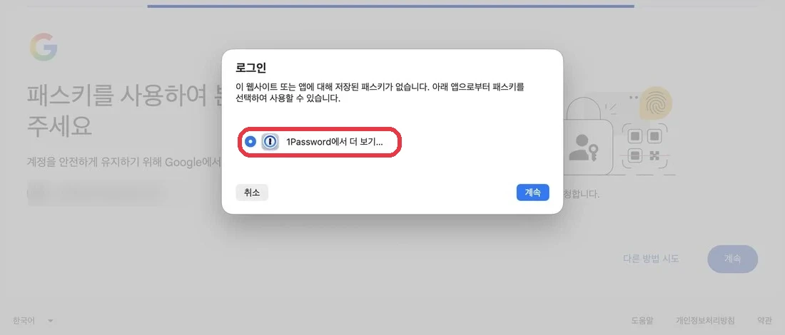

- **iCloud 키체인**을 고르면 Touch ID 확인 후 바로 로그인됩니다.
- **1Password**를 고르면 1Password 창이 열리고, 저장된 Google 패스키를 선택하면 로그인됩니다.

다른 사람 PC처럼 패스키가 없는 기기에서는 `다른 방법 시도` → 다른 기기의 패스키(QR 코드)를 고르세요. iPhone 카메라로 QR을 찍고 Face ID로 확인하면 로그인됩니다.

## 5. 문제 해결: 1Password 패스키가 안 보일 때

제가 실제로 막혔던 부분입니다. iCloud 패스키는 잘 되는데, 1Password를 고르면 이렇게 **항목 없음**만 나왔어요.

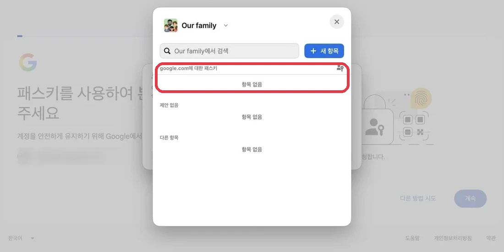

### 5-1. 패스키 항목부터 찾기

먼저 1Password 안에 패스키가 정말 있는지 확인합니다.

- 1Password 데스크톱 앱에서 **`패스키`**로 검색하면 패스키가 들어 있는 항목만 추려서 볼 수 있습니다. `google`로 검색하면 "Google(으)로 로그인" 항목까지 잔뜩 나와서 찾기 어렵습니다.
- 찾은 항목의 **마지막 편집 시각**이 구글 계정 페이지의 1Password 패스키 **생성 시각**과 같은지 비교해 보세요.

제 경우에는 LastPass에서 가져온 기존 `구글` 항목 안에 패스키가 들어 있었습니다. 마지막 편집 시각이 구글에 표시된 생성 시각과 초 단위까지 같았어요.

  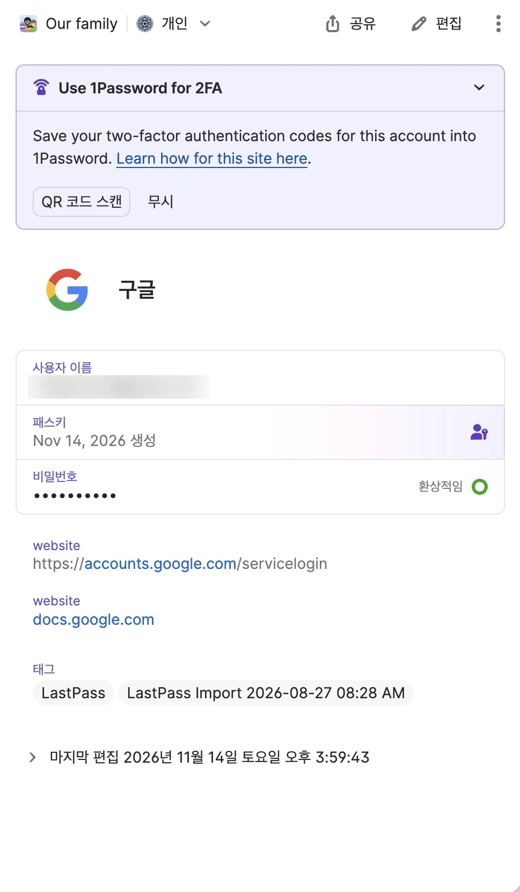

> 이 과정에서 제목이 "로그인 정보"이고 웹사이트가 비어 있는 항목이 여러 개 생겨 있었습니다. 패스키를 저장하고 로그인을 시도하는 동안 1Password가 비밀번호만 따로 저장한 중복 항목이었어요. 비밀번호가 같은지 확인하고 정리하면 덜 헷갈립니다.

### 5-2. 원인: 1Password 창이 아니라 macOS 창이 뜨고 있었다

위 스크린샷을 다시 보면, 처음 뜬 **로그인 – 1Password에서 더 보기…** 창은 1Password 확장 프로그램 창이 아니라 **Chrome/macOS 기본 패스키 창**입니다. 확장 프로그램이 패스키 요청을 직접 받지 못해서 macOS를 거쳐 1Password로 넘어갔고, 이 경로에서는 1Password가 macOS에 미리 알려 둔 패스키 목록만 보입니다. 새로 만든 패스키가 그 목록에 아직 반영되지 않았던 거예요.

### 5-3. 해결 방법

아래 순서대로 해 보세요.

1. **1Password 확장 프로그램이 패스키 요청을 직접 받게 하기**
   Chrome의 1Password 아이콘 → `⋯` → `설정` → `자동으로 채우기 및 저장` → **패스키로 로그인하도록 제안** 켜기. 이미 켜져 있다면 껐다가 다시 켭니다. 이게 켜져 있으면 macOS 창 대신 1Password 창이 바로 뜹니다.
2. **1Password 앱 설정 확인하기**
   `1Password` → `설정…` → `자동으로 채우기`에서 **패스키 제안 표시**가 켜져 있는지, **다음에서 자동 입력 제안 표시**가 패스키를 저장한 계정으로 되어 있는지 확인합니다. (위 2-2절 ③의 스크린샷 참고)
3. **macOS 쪽 패스키 목록 새로 고치기**
   `시스템 설정` → `일반` → `자동 완성 및 암호`에서 1Password 체크를 껐다 켜고, 1Password 앱을 완전히 종료(`⌘Q`)했다가 다시 실행합니다.
4. **시크릿 창에서 다시 로그인해 보기**
   패스키 → 1Password를 선택했을 때 `google.com에 대한 패스키` 아래에 항목이 보이면 성공입니다.

> **주의:** 1Password에서 패스키가 안 보인다고 해서 구글 계정의 1Password 패스키를 바로 지우지 마세요. 대부분은 패스키가 엉뚱한 항목이나 볼트에 저장돼 있거나, 위처럼 연결 설정 문제입니다. 항목을 먼저 찾아보는 게 순서입니다.

## 6. 정리

- 패스키는 **기기에 저장된 개인키로 로그인하는, 피싱이 안 되는 비밀번호 대체 수단**입니다.
- 한 계정에 패스키를 **여러 개** 등록할 수 있습니다. iCloud 키체인과 1Password에 하나씩 두면 백업 효과도 있습니다.
- iPhone과 Mac 모두 **iCloud 동기화**와 **자동 완성 제공자** 설정을 먼저 확인하세요.
- 1Password 패스키가 안 보이면 `패스키`로 검색해서 **항목부터 찾고**, 확장 프로그램의 **패스키 설정**을 확인하세요.

이제 구글 로그인은 Touch ID 한 번이면 끝입니다. 다른 서비스도 패스키를 지원한다면 하나씩 바꿔 보는 걸 추천합니다.
